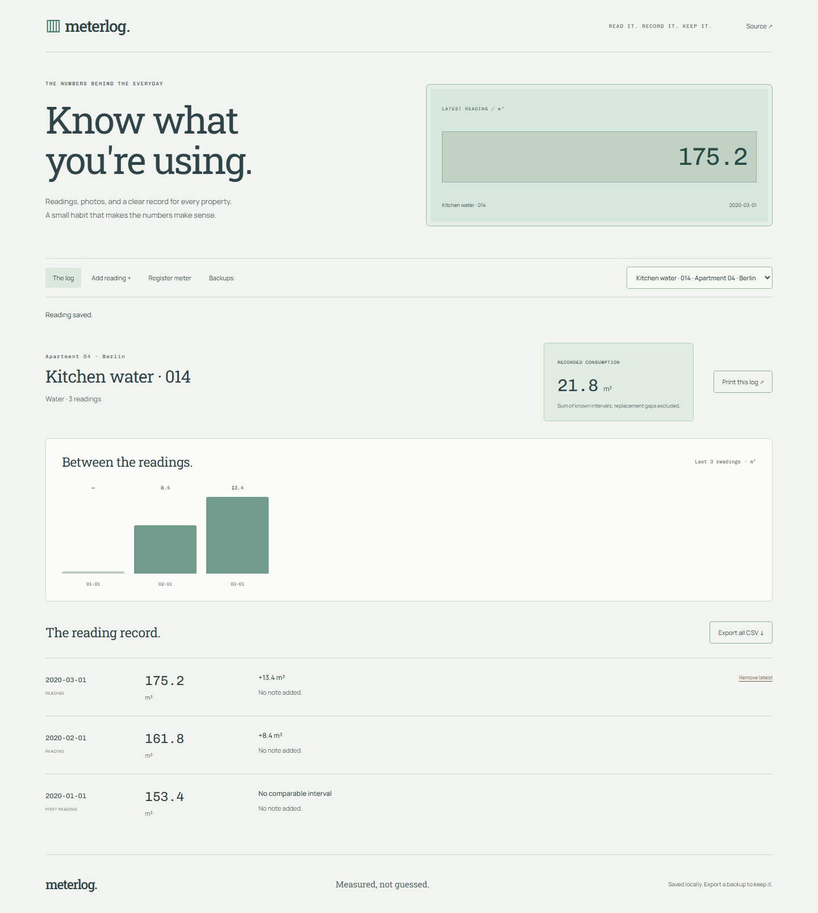

# Meterlog

A practical record of apartment meter readings, with optional photo evidence. Keep a baseline, see usage between readings, and distinguish a replaced meter from an impossible negative consumption figure.

[Open the application](https://goshkaaaa.github.io/meterlog/) · [Mobile screenshot](docs/mobile.png)



## What works

Register electricity, water, or gas meters at different properties. Add dated readings with up to three decimal places, an optional note, and an optional photo. The chronological log calculates usage between consecutive readings, including readings entered out of order. Duplicate days and decreasing values are rejected unless a replacement/reset is explicitly recorded.

A replacement becomes a new baseline. Usage across that gap is unknown and excluded from the displayed total. The chart shows the last ten reading intervals, not calendar-month estimates. Only the latest reading can be removed, allowing correction without silently rewriting older intervals.

Print a meter's log, export all readings as CSV, or back up the complete workspace including photos. The application starts with no meters or readings; there is no demo mode or simulated data source.

## Run and verify

Use Node.js 24 LTS.

```sh
npm ci
npm run dev
npm run lint
npm run check
npm test
npx playwright install chromium
npm run test:e2e
npm run build
npm run preview
```

Svelte 5, JavaScript, Vite, and IndexedDB through `idb`. Decimal readings are stored as integer thousandths, avoiding floating-point subtraction drift. The production build is `dist/`; GitHub Pages builds use `/meterlog/`.

## Data and photos

Everything is saved in this browser. Read/write transactions validate the latest database state before saving; open tabs receive updates. Photos are decoded and resized on the device, then encoded as WebP without source metadata. Original uploads are not retained or sent to a server.

Limits: 100 meters, 2,000 readings, 5 MB source images, 350,000 characters per processed photo, and a total 10 MB photo budget. Backups can be imported up to 15 MB. Restore requires an explicit replacement choice and validates dates, relationships, monotonic readings, and photo types. In-session undo is available. Clearing browser data removes local records.

There are no user accounts, remote sharing, automatic meter connections, tariffs, invoices, or estimates of utility bills. Water and gas are recorded in cubic metres, and electricity in kWh. Check the physical unit on your meter before registering it. Use one browser profile for your own records; this is not a multi-user property management server.

Tests cover exact decimals, chronological differences, resets, backdated values, duplicate dates, invalid image types, and latest-reading correction. Desktop/mobile browser tests check real data entry, persistence, consumption, exports, invalid backups, empty startup, and accessibility. Screenshot records were entered during QA, not seeded for visitors.

Optional Google Fonts have local fallbacks. MIT license.
